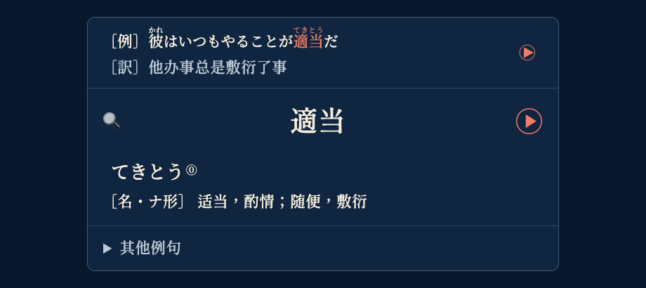

# egg rolls JLPT · 例句听力版

基于 [egg rolls 的 JLPT N1–N5 一万词牌组](https://github.com/5mdld/anki-jlpt-decks)。这版把例句作为听力的基本单位。先听懂这句话，再看目标词在这个语境里怎么用。一个词有几种常见搭配，就有机会分别听到它们。

| 日间 · 听力题面 | 夜间 · 词义答案 |
| --- | --- |
|  |  |

## 怎么学

- **音→意**覆盖有录音的普通例句。同一个词的不同搭配可以各练一次。翻面先显示刚听到的日文与译文。
- **形→音**练看见写法后读出目标词。题面保留原句里的活用，参考答案使用辞书形。
- **形→意**只挑值得单独辨认的词义。例如「適当」表示「适宜」时可以借中文理解，表示「敷衍」时才单独出题。
- **完形**练少数自他用法和搭配。例句和提示按题校订，能用原句语境区分答案的题优先保留。

同一词条的新卡按文字、听力、完形排列。没有必要单独考写法或词义的词可以从听力开始。具体开卡条件见 [开卡规则](DECK-RULES.md)。

## 导入与设置

打开构建生成的 `dist/eggrolls-jlpt-listening.apkg`。导入时可勾选「导入牌组选项预设」，使用包内的新卡顺序。牌组包含录音和字体。

在「卡片模板 → 样式」顶部可设置简繁、输入框、播放速度和日夜配色。白天默认真朱，夜间默认紺 × 珊瑚朱。文字使用源雲明體月版和源雲明朝。桌面用户还可以安装 [倍速插件源码](desktop_audio_speed.py)，让原生自动播放读取同一个速度设置。

## 跟随上游构建

需要 Git 和 uv。当前校订以 egg rolls 的 `26.11.20` 为基准。

```sh
git clone --depth 1 --branch 26.11.20 https://github.com/5mdld/anki-jlpt-decks.git ../anki-jlpt-decks
uv run build_deck.py --upstream ../anki-jlpt-decks
```

[editorial.json](editorial.json) 保存按词条和例句核对过的文字卡决定。[cloze-review.tsv](cloze-review.tsv) 保存逐题定稿。构建会核对例句，输出 `dist/deck-audit.json`。公开构建包使用上游素材和项目校订，本机学习进度、个人备注保存在自己的 Anki 集合。

## 来源

词汇和录音来自 [egg rolls JLPT 牌组](https://github.com/5mdld/anki-jlpt-decks)，适用 [CC BY-NC 4.0](UPSTREAM-LICENSE.txt)。完形渲染使用 [Cloze Anything v0.3](https://github.com/matthayes/anki_cloze_anything)，适用 Apache 2.0。字体来自 [源雲字体](https://github.com/ButTaiwan/genwan-font)，适用 SIL Open Font License 1.1。配色参考 [NIPPON COLORS](https://nipponcolors.com/)。
